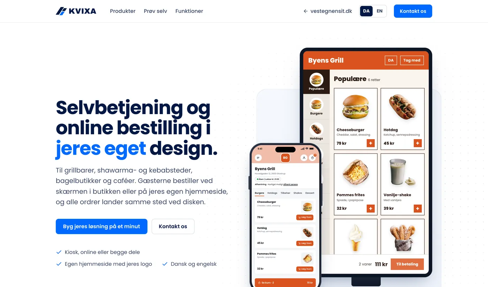
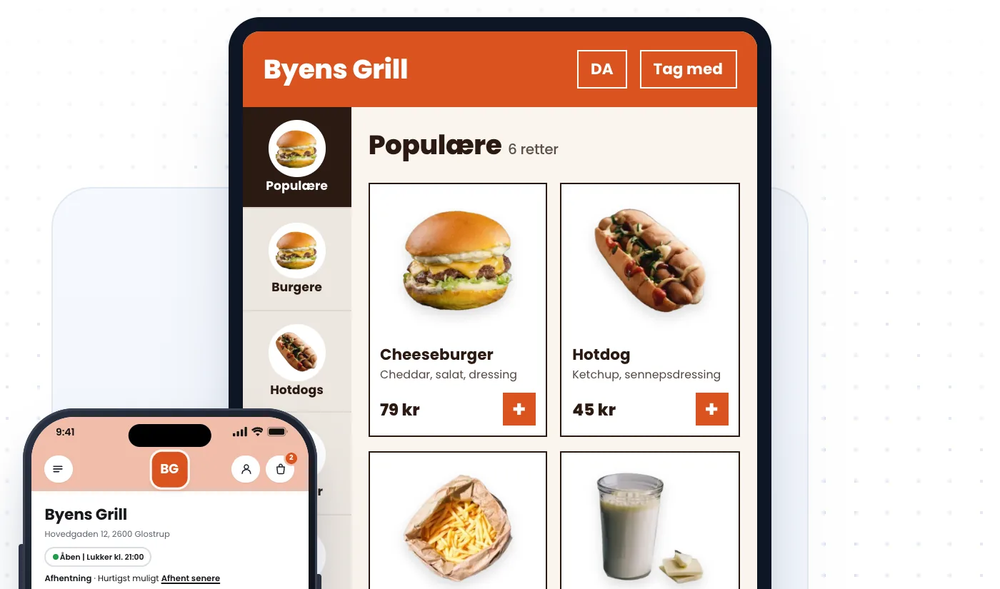

  

  
  
  

> This repository shows the project. The source code is not public.

## What it is

Kvixa gives grill bars, cafés and takeaways self-service kiosks and online ordering. Guests order at the kiosk in the shop or on the restaurant's own website, with one menu behind both. Every order lands on one counter screen, and pickup numbers show on an ordinary TV. The restaurant changes its menu, prices and more itself.

## Built with study friends

I co-developed Kvixa together with study friends. We built it to see if we could make a complete ordering system, and to test it in daily use.

## In daily use

I helped launch Kvixa at Chicken N Chicken Waves in Greve, where the orders now come in through Kvixa every day. You can see the ordering page on [chickenwaves.dk](https://chickenwaves.dk).

## Screenshots

  
   
  <em>The Kvixa website: kiosk and online ordering in the restaurant's own design</em>

  
   
  <em>A Kvixa kiosk menu and the matching ordering page on a phone</em>

## Stack

  
  
  
  
  

Node.js, Express and MongoDB run the ordering and the menu. The kiosk app is built in Kotlin and the counter and pickup screens in Flutter.

---

Made by [Yasir Lokman Teksen](https://github.com/Teksen42) and study friends. More about me on [teksen42.github.io](https://teksen42.github.io).
